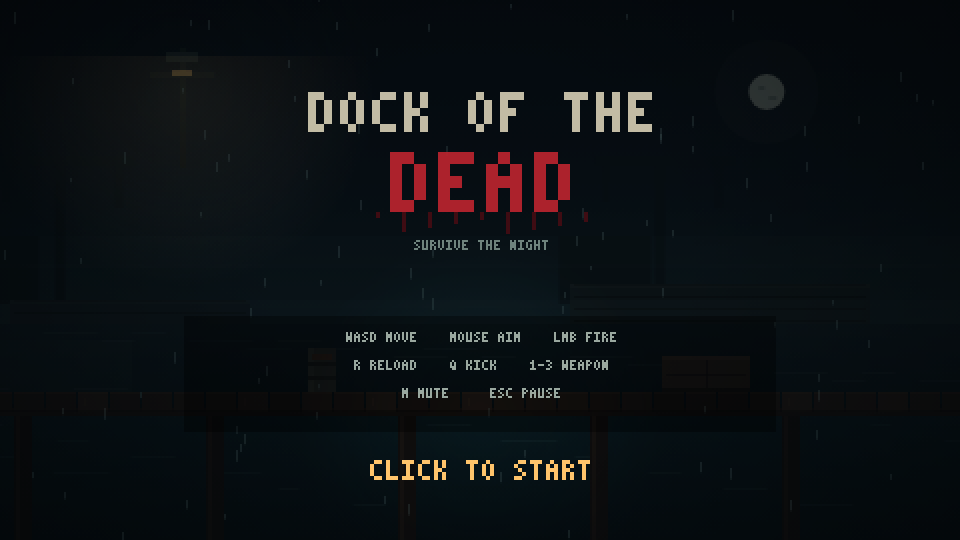

# 码头尸潮 · Dock of the Dead




一款在浏览器中运行的 **2D 横版像素风恐怖僵尸生存游戏**。雨夜、码头、无尽尸潮，
用枪械、霰弹与冲锋枪撑过一波又一波。核心是重口味的命中反馈：定格、震屏、白闪、
定向喷血、断肢、爆头慢动作、程序化音效。

- 纯 Canvas 2D，内部分辨率 480×270，整数倍缩放，像素清晰
- 零外部素材：所有像素图、音效、音乐氛围均在运行时程序化生成
- 零运行时依赖：双击 `index.html` 即可游玩

## 运行

**方式一（最简单）：** 双击 `index.html`。

**方式二（本地服务器）：**

```bash
python -m http.server 8765
# 打开 http://localhost:8765
```

浏览器建议使用 Chrome / Edge。首次点击或按键后才会启用音频（浏览器自动播放限制）。

## 操作

| 操作 | 按键 |
|---|---|
| 移动 | `A` / `D` 或 `←` / `→` |
| 跳跃 | `Space` / `W` / `↑` |
| 瞄准 | 鼠标（360° 自由瞄准） |
| 射击 | 鼠标左键（按住连发） |
| 换弹 | `R` / `Shift` |
| 踹击（击退解围） | `Q` / `F` |
| 切换武器 | `1` 手枪 / `2` 霰弹枪 / `3` 冲锋枪，或滚轮 |
| 暂停 | `Esc` |
| 静音 | `M` |
| 死亡后重开 | `R` |

## 玩法

- **目标**：在码头上活过尽可能多的波次。无尽模式，死亡结算。
- **武器**：手枪（12 发、备弹无限、精准）、霰弹枪（8 弹丸、强击退）、
  冲锋枪（高射速、扩散大）。每把枪独立弹药，波间补给与击杀掉落可补充。
- **僵尸**：游荡者（基础）、爬行种（低矮快速、会扑咬）、壮汉（高血量、抗击退，
  第 2 波起出现）。它们会从左右两端走上栈桥，也会从水里爬上甲板。
- **断肢**：四肢累计受到 30 点伤害后断离；断肢会带血翻滚并留在地上。
  爆头击杀会炸开头颅并触发短暂慢动作。
- **波次**：预算随波次增长，每 5 波为精英潮（僵尸血量 ×1.25，分数 ×2）。
  波间 8 秒喘息，掉落弹药/医疗包，远处响起雾笛。
- **命中反馈**：定格 40–70ms、分级震屏、受击白闪、定向血雾、地面血渍、
  准星命中标记、枪口火光作为动态光源、弹壳抛出。

## 调试参数

在 URL 后追加：

| 参数 | 作用 |
|---|---|
| `?debug=1` | 显示 FPS、实体计数、红色碰撞盒 |
| `?god=1` | 无敌 |
| `?wave=5` | 从第 5 波开始（精英波） |
| `?muted=1` | 静音启动 |
| `?debug=horde` | 在玩家周围生成 8 只僵尸用于测试 |
| `?debug=gore` | 脚本化展示爆头/断肢/血渍 |

## 开发

```bash
npm test                     # Node 内置测试：数学/对象池/时间缩放/伤害/波次/拾取/UI
npm run shot -- <url> <out>  # 需要本地服务器 + 系统 Edge（开发用截图/交互）
npm run sim -- <url> 45      # 自动瞄准射击的长时间模拟，观察波次与性能
```

- 测试：`tests/*.test.js`，纯规则模块不依赖 DOM。
- 截图/交互：`tools/shot.js`（场景：`title`、`fight`、`headshot`、`shotgun`、
  `loot`、`pause`、`gameover`、`audio`、`states`、`elite`）。
- 长时间模拟：`tools/sim.js`。
- `playwright-core` 仅作为开发依赖，用于驱动系统 Edge；游戏本身无任何依赖。

### 文件结构

```
index.html          页面骨架、画布、脚本加载顺序
style.css           居中、黑边、像素化缩放
js/core.js          常量、内容配置、数学、随机、对象池、输入、时间缩放
js/gfx.js           画布、相机、震屏、旋转缓存、调色板
js/sprites.js       像素部件骨架、武器、3×5 像素字体
js/level.js         码头布局、视差、水面、灯光、雨雾、血渍层
js/waves.js         波次预算与僵尸组成（纯规则）
js/combat.js        伤害区域、定格/震屏分级、射线与盒相交（纯规则）
js/particles.js     血、骨屑、弹壳、火花、烟（池化）
js/player.js        玩家、武器、子弹
js/entities.js      僵尸 AI、断肢、拾取物
js/audio.js         WebAudio 程序化枪声/血肉/低吼/环境音/心跳
js/hud.js           HUD、标题、暂停、结算、最高分、调试碰撞盒
js/game.js          状态机、波次导演、碰撞、主循环
```

## 已知限制

- 仅支持桌面键鼠，无触屏与手柄。
- 画布内文字为自制 ASCII 像素字体，因此游戏内界面为英文；中文仅存在于文档。
- 仅保存最高分（`localStorage`），无存档/关卡/剧情。
- 低帧率时会自动降低粒子上限并减少雨丝（标为 `LOWFX`）。
