# 码头尸潮 · Dock of the Dead

**在线试玩：** https://lanmeibuxie.github.io/dock-of-the-dead/

一款在浏览器中运行的 **2D 横版像素风恐怖僵尸生存游戏**。雨夜与白昼轮换的码头上，
面对最多 120 只同屏的无尽尸潮，用枪械、转轮机枪、榴弹发射器与喷气背包活下去。

- 纯 Canvas 2D，内部分辨率 480×270，整数倍缩放
- 零外部素材：像素图、音效、中文位图字体全部程序化生成
- 零运行时依赖：双击 `index.html` 即可游玩

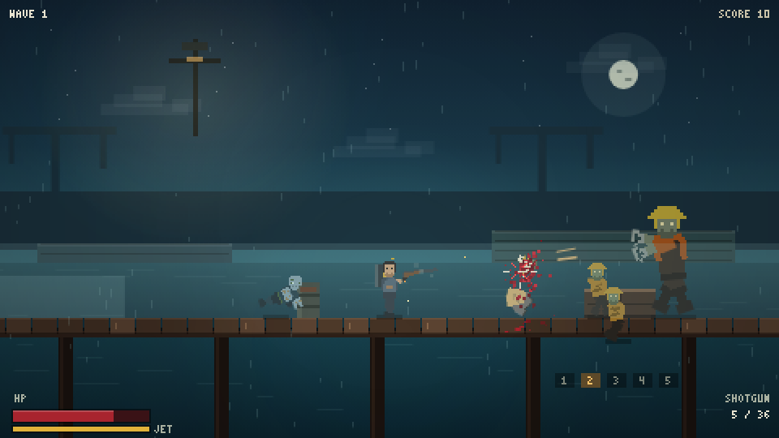

## 运行

**方式一：** 双击 `index.html`。

**方式二：** `python -m http.server 8765`，打开 `http://localhost:8765`。

首次点击或按键后才会启用音频（浏览器自动播放限制）。

## 操作

| 操作 | 按键 |
|---|---|
| 移动 | `A` / `D` 或 `←` / `→` |
| 跳跃 | `Space`（轻按） |
| 喷气背包 | 空中按住 `Space`（消耗燃料） |
| 瞄准 / 射击 | 鼠标 360° / 左键（按住连发） |
| 换弹 | `R` / `Shift`（受击不会打断） |
| 踹击 | `Q` / `F` |
| 武器 | `1` 手枪 · `2` 霰弹 · `3` 冲锋枪 · `4` 转轮 · `5` 榴弹，或滚轮 |
| 选择强化 | 点击卡牌 / `1` `2` `3` |
| 确认强化 | 点击「确定」/ `Enter`（双击无效） |
| 刷新强化 | 强化界面点「刷新」/ `R`（每波 1 次） |
| 商店 | 点击商品购买 / `1-4`；`R` 刷新；`Enter` 离开 |
| 暂停 / 静音 | `Esc` / `M` |
| 死亡重开 | `R` |

## 本次版本重点

### 巨量尸潮与无尽波次

- 波次预算 `8 + 4 × wave`，同屏僵尸上限 `min(120, 18 + 4 × wave)`。
- 刷怪间隔从 0.5s 逐步压缩到 0.12s，后期一次刷 2–3 只。
- 僵尸每波生命 +10%、伤害 +4%、移速 +1.2%（上限 +35%），每 5 波精英潮。
- 没有波次上限；目标是让合理 build 撑到 15–20 波以上。

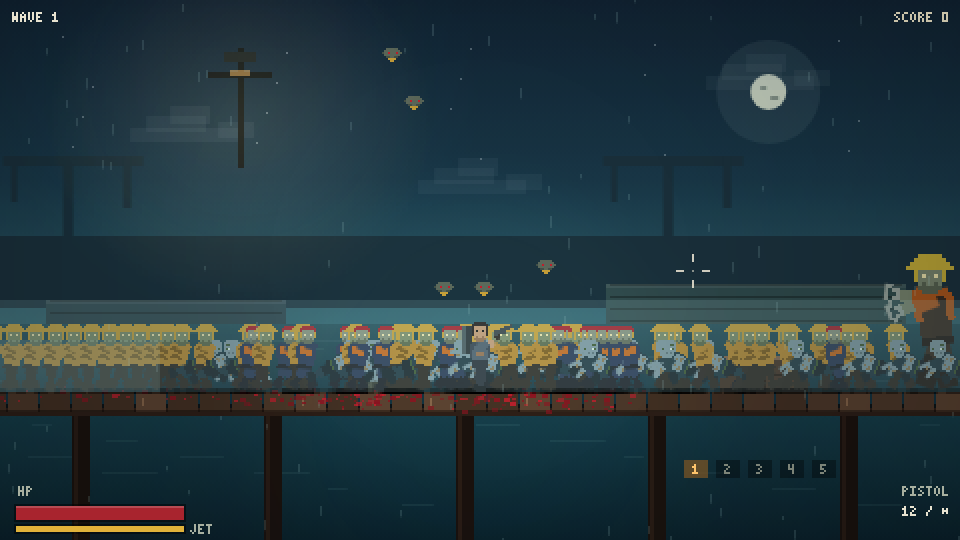

### 白天与夜晚轮换

- 第 1–3 波夜晚 → 4–6 波白天 → 7–9 波夜晚，循环，1.5 秒渐变。
- 夜晚有路灯、雨、雾与压迫感，但整体明显提亮；白天是蓝天白云+太阳，路灯关闭、无雨、鸟群更多。
- 夜晚整体亮度已提高，暗角和遮罩大幅减弱。

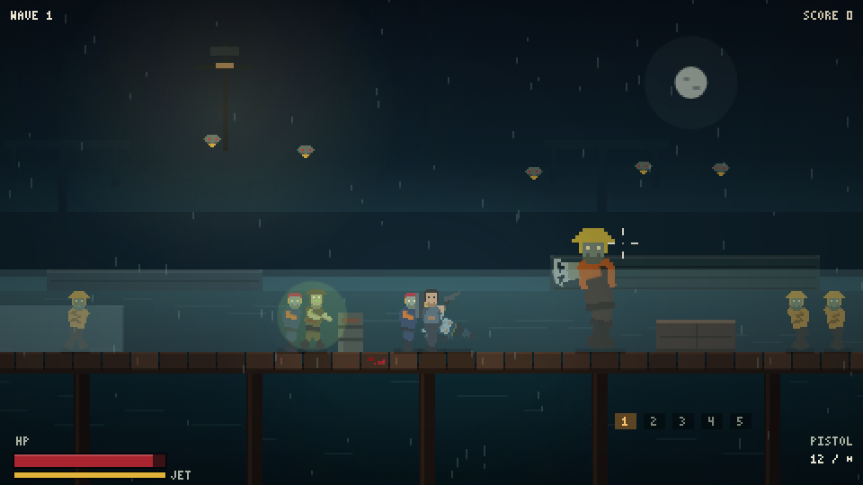
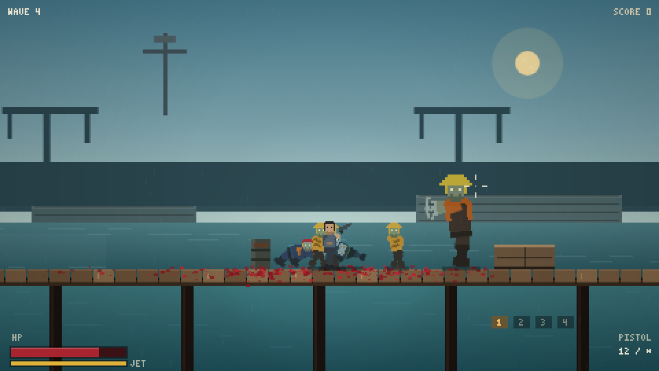

### 喷气背包

- 空中按住 `Space` 持续上升，燃料 100，消耗 50/s；**仅落地回充** 40/s。
- 上升速度上限约 140px 高度；空中水平移速为地面的 90%。
- 有背包、喷射火焰、烟与噪音；HUD 血条下方是黄色燃料条。
- 相关强化卡：火箭燃料（大幅提升燃料与回充）、空中猎手（空中增伤/加速）、防爆护甲。

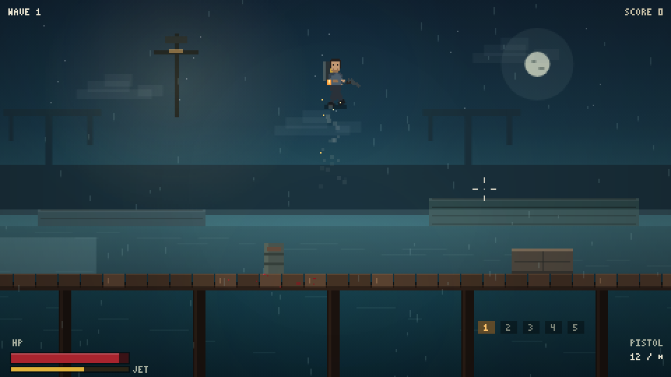

### 榴弹发射器

- 第 5 武器槽：弹匣 4 / 备弹 12，爆炸半径 58。
- 中心 60、边缘 25 伤害；可引爆自爆种、炸鸟群、清理尸堆。
- **自伤**：爆心约 30，按 2D 距离衰减；贴地连射会伤到自己，飞在空中向下轰炸则安全。
- 「防爆护甲」最多减免 70% 爆炸自伤。

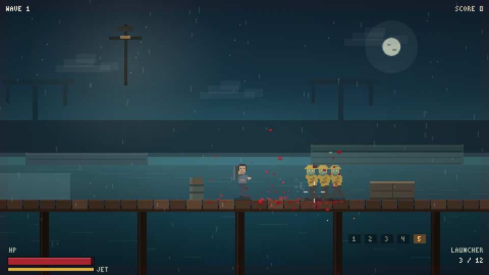

### 被感染的鸟群

- 第 4 波起出现，在玩家上方盘旋 → 俯冲 → 拉升；地面玩家同样是目标，俯冲间隔约 1.1 秒；接触伤害 10，生命 18。
- 同屏最多 15 只，白天出现更多；被击落后带血坠地。
- 喷气背包悬停时，鸟群是主要威胁。

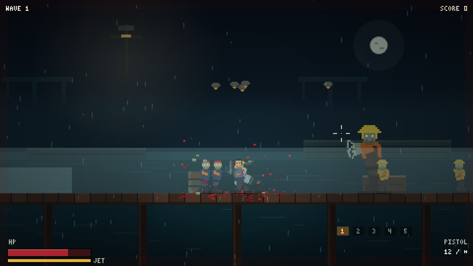

### 码头风僵尸

| 类型 | 造型 | 特性 |
|---|---|---|
| 游荡者 | 渔夫：油布雨衣、防水帽、胶靴 | 基础型 |
| 爬行种 | 落水者：湿潜水服、渔网、海藻 | 低矮、扑咬 |
| 壮汉 | 装卸工：反光背心、安全帽、铁钩手 | 高血量、抗击退 |
| 疾行者 | 领航员：海员外套、救生衣、红头巾 | 极快、前摇短 |
| 自爆种 | 油桶怪：油污雨衣、锈蚀油桶、绿光 | 引信爆炸、连锁 |

### Boss 波

从第 10 波开始，每 5 波出现一个 Boss（吊机尸 / 巨溺者轮流），顶部显示中文名字与血条：

- **吊机尸**：地面砸击产生双向冲击波，并持续投落货箱。
- **巨溺者**：抛射三发酸液，落地形成毒池；定期召唤爬行种。
- Boss 波奖励：下一轮强化必定包含 1 张史诗卡。

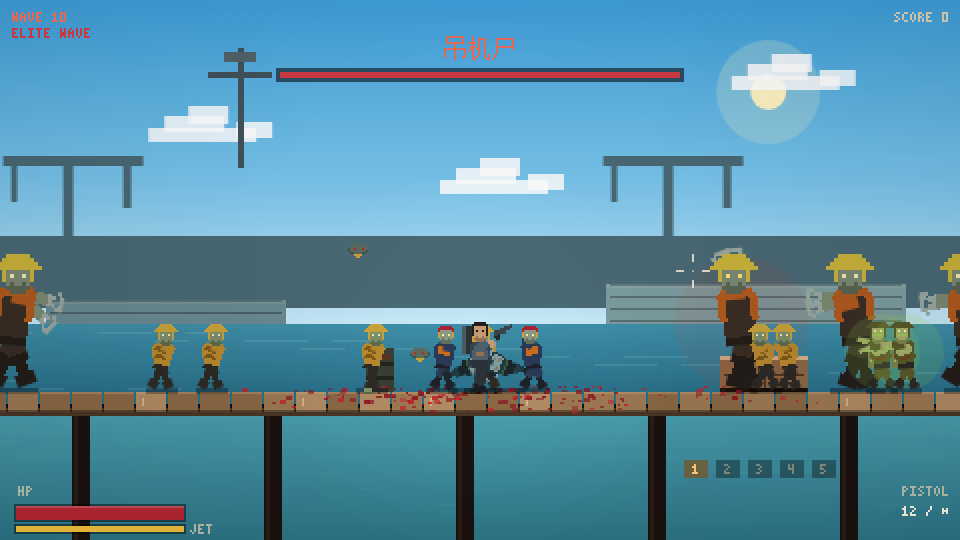

### 波次词缀

第 8 波起随机出现，Boss 波除外：

| 词缀 | 效果 |
|---|---|
| 涨潮 | 水位上涨、甲板被淹，更多僵尸从水中爬出 |
| 停电 | 路灯熄灭、视野变暗，鸟群增多 |
| 血月 | 僵尸更快更痛，但分数 ×1.5、额外补给 |
| 空投 | 战场额外掉落补给，并多 1 次刷新 |

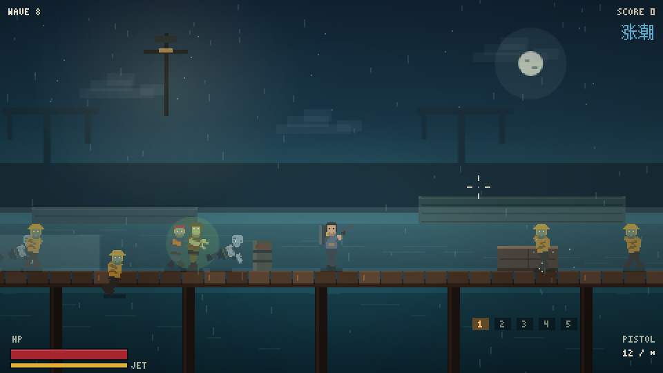

### 精英词缀与金币商店

- 第 6 波起普通僵尸有 12% 概率变成精英：
  - **装甲**：生命 ×1.6、移速 -20%、伤害 +10%
  - **迅捷**：移速 ×1.6、生命 -20%
  - **爆裂**：死亡时爆炸（半径 46）
  - 精英分数 ×1.5、金币 +3，并有对应颜色光环。
- 击杀、清波、Boss 都会获得金币；清波后先选强化卡，再进入**补给商店**。
- 商店有 4 件商品（8 选 4），可用金币购买：猎手徽章、铁皮护甲、冷却核心、高爆核心、磁力核心、燃料电池、医疗包、全弹药补给。
- 商店可花 2 金币刷新，点「离开」或 `Enter` 继续下一波。

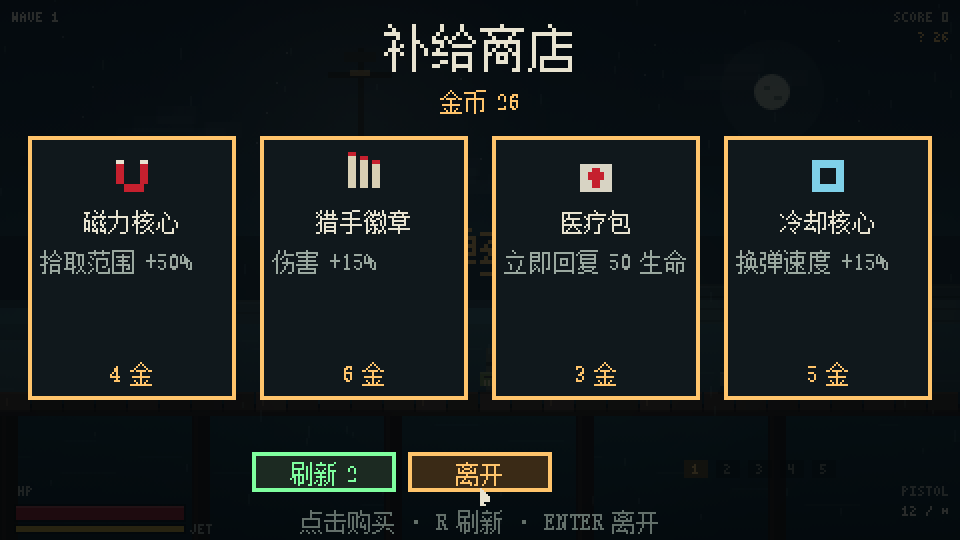

### 强化与确认

- 每波清空后出现 3 张中文强化卡，共 32 张，分普通/稀有/史诗。
- **点击只选中，必须点「确定」或按 `Enter` 才生效**；双击卡牌不会确认，避免误点。
每波有 1 次免费刷新（空投词缀额外 +1），也可按 `R`。

新增代价/机制卡：玻璃大炮、超频、爆裂弹头、爆破炉心、弹药打印机、吸血力场、肾上腺素、背水一战。
卡片带 **爆破 / 空军 / 弹药 / 血怒** 标签，凑到 3/6 层触发套装加成。
- 卡牌可叠加，满级后不再出现。

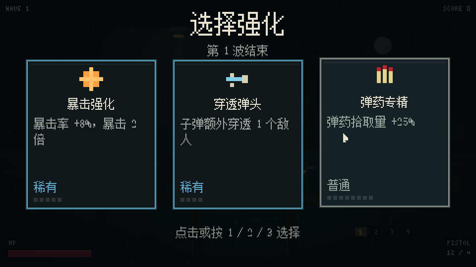

### 换弹动画

枪身下沉旋转、旧弹匣抛出翻滚、新弹匣滑入，最后火花与金属声收尾。

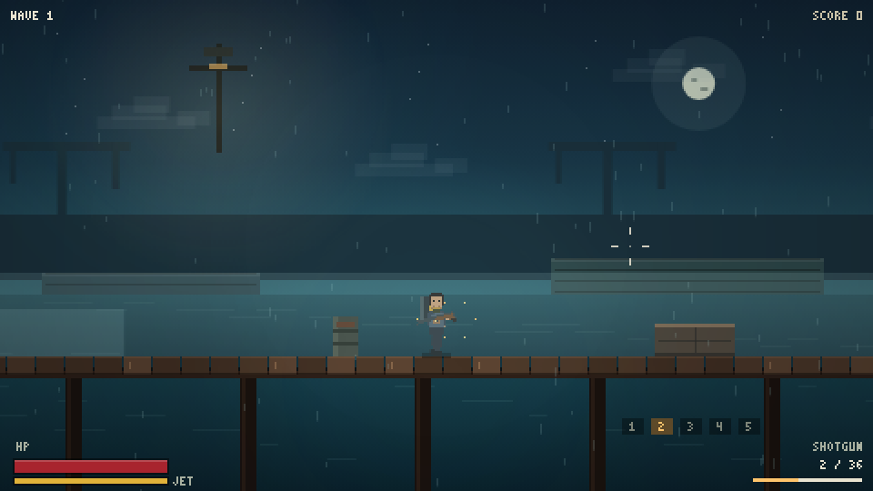

### 弹药补给

每波清空必掉一个 **全武器弹药箱**（霰弹 +6、冲锋枪 +20、转轮 +60、榴弹 +4），另有随机补给；
击杀也有概率掉落。转轮/榴弹不再缺弹。

### 性能与可读性

- 屏幕外单位不绘制；远处僵尸 AI 降频；子弹命中先做粗筛。
- 静态渐变/灯光贴图缓存，粒子/弹壳池化；尸体上限 30、断肢 20。
- 120 僵尸 + 5 鸟压力测试可维持约 60fps；低帧率时自动降级雨丝与粒子。
- 震屏幅度约减半，最大位移约 2–3px；**同一次射击只触发一次定格/震屏/慢动作**，穿透多杀不再连续卡顿。
- 瞄准使用无震屏的稳定相机坐标，震屏时准星不会漂移。

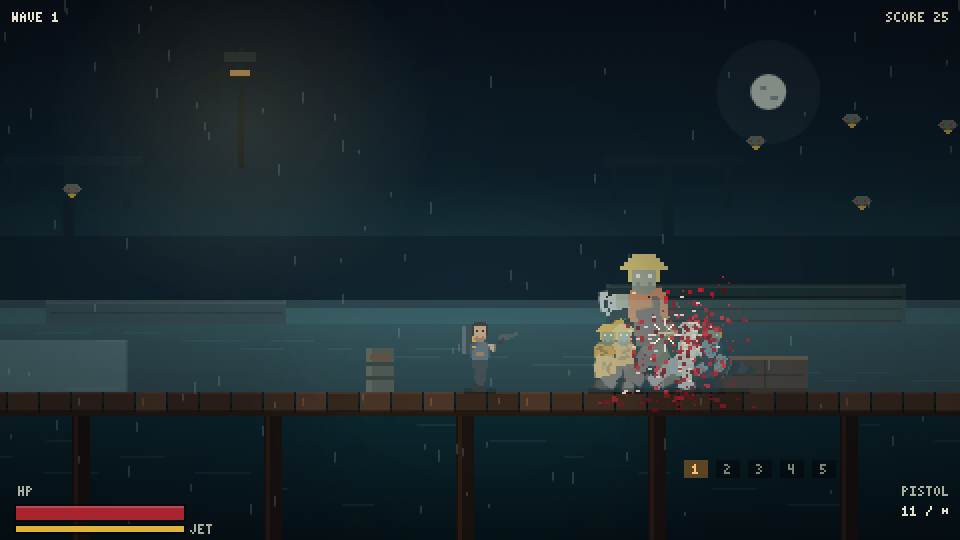

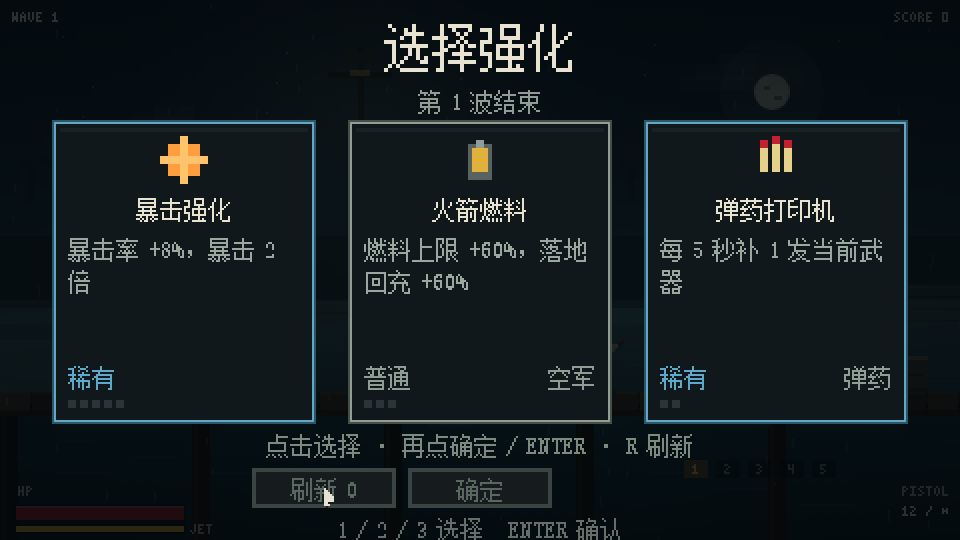

## 调试参数

| 参数 | 作用 |
|---|---|
| `?debug=1` | FPS、实体计数、红色碰撞盒 |
| `?god=1` | 无敌 |
| `?wave=5` | 从第 5 波开始 |
| `?muted=1` | 静音启动 |
| `?debug=horde` | 生成全部僵尸类型 + 5 只鸟 |
| `?debug=horde&horde=120` | 生成 120 只僵尸做压力测试 |
| `?debug=upgrade` | 直接打开强化确认界面 |
| `?debug=shop` | 带 20 金币直接打开补给商店 |
| `?wave=8&mod=tide` | 强制第 8 波使用指定词缀（tide/blackout/bloodMoon/airdrop） |

## 开发

```bash
npm test                     # 69 项规则/卡池/字体/命中/Boss/词缀/商店/确认/刷新测试
npm run font                 # 修改中文文案后重新生成中文位图字体
npm run shot -- <url> <out>  # 系统 Edge 截图/交互
npm run sim -- <url> 60      # 自动瞄准 + 自动选卡的长时模拟
```

- 截图场景：`title`、`fight`、`headshot`、`shotgun`、`minigun`、`launcher`、
  `bomber`、`jet`、`reload`、`birdattack`、`pierce`、`perf`、`horde`、`upgrade`、`upgradepick`、
  `upgradesel`、`upgradedouble`、`pause`、`gameover`、`audio`、`states`、`elite`。
- `playwright-core` 仅作为开发依赖驱动系统 Edge；游戏本身没有依赖。

### 文件结构

```
index.html          页面骨架、画布、脚本顺序
style.css           居中、黑边、像素化缩放
js/core.js          常量、内容配置、输入、时间缩放
js/gfx.js           画布、相机、震屏、旋转缓存
js/sprites.js       玩家骨架、武器、3×5 像素字体
js/zombieart.js     五种码头风僵尸部件与调色板
js/level.js         码头、视差、水面、灯光、血渍、昼夜混合
js/themes.js        夜/昼配色与插值
js/waves.js         成长、预算、同屏上限、刷怪节奏、鸟解锁
js/combat.js        伤害区域、定格/震屏、射线检测、爆炸自伤公式
js/hits.js          子弹命中、穿透、暴击、断肢、鸟群命中
js/particles.js     血、骨屑、弹壳、火花、烟、羽毛
js/weapons.js       武器与子弹
js/director.js      波次导演、Boss 波、刷怪、强化流程
js/hazards.js       Boss 场地危险（冲击波/落箱/酸液）
js/modifiers.js     波次词缀
js/player.js        玩家、喷气背包、换弹动画、属性
js/entities.js      僵尸 AI、断肢、拾取、爆炸触发
js/birds.js         被感染的鸟群
js/grenade.js       榴弹实体
js/boom.js          爆炸、自伤、连锁
js/melee.js         踹击
js/upgrades.js      32 张强化卡、标签与套装
js/shop.js          商店商品、购买与属性应用
js/shopui.js        补给商店界面
js/cnfont.js        生成的中文位图字体
js/upgradeui.js     强化卡界面与确认交互
js/render.js        世界绘制与裁剪
js/audio.js         程序化枪声/血肉/低吼/爆炸/喷气/环境音
js/hud.js           HUD、标题、暂停、结算、燃料条、最高分
js/debug.js         调试场景
js/game.js          状态机、波次导演、主循环
tools/genfont.py    中文字体生成器
tools/shot.js       截图/交互脚本
tools/sim.js        长时自动模拟
```

## 已知限制

- 仅支持桌面键鼠，无触屏与手柄。
- HUD 为英文像素字，强化卡为中文像素字。
- 仅保存最高分（`localStorage`），无存档/关卡/剧情。
- 120 同屏在低端设备上可能触发 `LOWFX` 降级。
