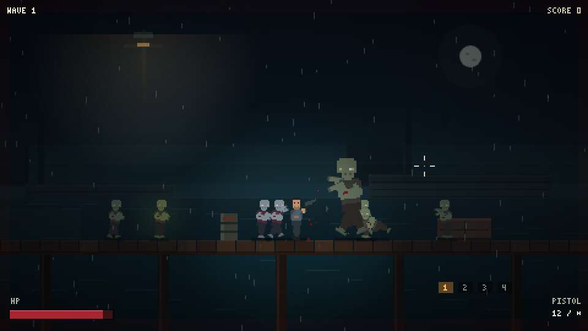
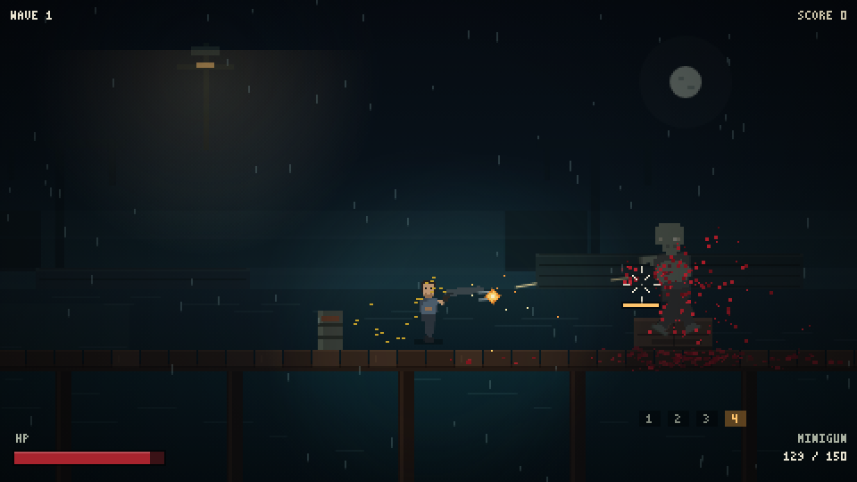

# 码头尸潮 · Dock of the Dead

一款在浏览器中运行的 **2D 横版像素风恐怖僵尸生存游戏**。雨夜、码头、无尽尸潮，
用枪械、霰弹枪、冲锋枪与转轮机枪撑过一波又一波。每波僵尸都会变强，清空一波后
可以从 3 张中文强化卡中选 1 张，逐步构筑自己的 build。

- 纯 Canvas 2D，内部分辨率 480×270，整数倍缩放，像素清晰
- 零外部素材：像素图、音效、中文位图字体全部在运行时/构建期程序化生成
- 零运行时依赖：双击 `index.html` 即可游玩


## 运行

**方式一（最简单）：** 双击 `index.html`。

**方式二（本地服务器）：**

```bash
python -m http.server 8765
# 打开 http://localhost:8765
```

浏览器建议使用 Chrome / Edge。首次点击或按键后才会启用音频（浏览器自动播放限制）。

## 操作

| 操作 | 按键 |
|---|---|
| 移动 | `A` / `D` 或 `←` / `→` |
| 跳跃 | `Space` / `W` / `↑` |
| 瞄准 | 鼠标（360° 自由瞄准） |
| 射击 | 鼠标左键（按住连发） |
| 换弹 | `R` / `Shift` |
| 踹击（击退解围） | `Q` / `F` |
| 切换武器 | `1` 手枪 / `2` 霰弹枪 / `3` 冲锋枪 / `4` 转轮机枪，或滚轮 |
| 选择强化 | 点击卡片或 `1` / `2` / `3` |
| 暂停 | `Esc` |
| 静音 | `M` |
| 死亡后重开 | `R` |

## 玩法

### 波次成长

每一波僵尸生成时都会变强：

| 属性 | 每波成长 | 上限 |
|---|---|---|
| 生命 | +10% | 无 |
| 伤害 | +4% | 无 |
| 移速 | +1.2% | +35% |

每 5 波为精英潮：生命再 ×1.25，分数 ×2。波次预算也会增长，因此后期数量与质量同时提升。

### 僵尸种类

| 类型 | 生命 | 速度 | 伤害 | 出场 | 特性 |
|---|---|---|---|---|---|
| 游荡者 Walker | 60 | 34 | 12 | 第 1 波 | 基础型 |
| 爬行种 Crawler | 28 | 78 | 8 | 第 1 波 | 低矮、会扑咬 |
| 壮汉 Brute | 260 | 24 | 26 | 第 2 波 | 高血量、抗击退 |
| 疾行者 Runner | 38 | 100 | 9 | 第 3 波 | 速度极快、前摇短 |
| 自爆种 Bomber | 70 | 30 | 26 | 第 5 波 | 靠近或死亡时引爆，可连锁 |

Bomber 爆炸半径 60，会伤害玩家并炸伤周围僵尸；被击杀也会引爆，小心连锁。



### 波间强化

每清空一波，世界暂停，出现 **3 张随机强化卡**：

- 鼠标点击或按 `1/2/3` 选择一张，随后进入 4 秒喘息（换弹、捡补给）并开始下一波。
- 卡片可重复获取并叠加，达到上限后不再出现。
- 稀有度分为 **普通 / 稀有 / 史诗**，边框颜色不同，权重随波次提高。

普通：伤害、射速、换弹、弹匣、生命、移速、击退、拾取范围、弹药量。
稀有：暴击、穿透、嗜血、后坐力、战地急救。
史诗：死神之眼、弹幕风暴、尸潮猎手、不灭意志。

完整卡表见 `docs/superpowers/specs/2026-10-19-dock-progression-and-minigun-design.md`。


### 转轮机枪

第 4 武器槽，开局即拥有，弹匣 150 / 备弹 150。

- 按住左键先旋转 0.55 秒才能开火，约 2000 RPM。
- 旋转期间移动速度降低 35%；松开后转速 0.5 秒回落。
- 换弹 3.2 秒；波间补给可拾取 60 发 `ammo_minigun`。
- 高射速下使用更短的命中定格，避免画面卡顿。
- 伤害、射速、弹匣、暴击、穿透、吸血等强化全部生效。



### 打击感

定格、分级震屏、受击白闪、定向喷血、地面血渍、断肢、爆头慢动作、枪口动态光、
命中标记、程序化音效（枪声/血肉/低吼/爆炸/心跳/雾笛）。暴击会额外迸发火花并显示黄色命中标记。

## 中文像素字体

卡面中文由 `tools/genfont.py` 生成：读取游戏源码里用到的所有中文字符，用宋体 12px
渲染后二值化，输出为 `js/cnfont.js` 位图图集。运行时逐像素绘制，与英文 3×5 像素字体
共用同一套像素规则，不需要任何外部字体或图片文件。

```bash
npm run font   # 修改中文文案后重新生成
```

## 调试参数

在 URL 后追加：

| 参数 | 作用 |
|---|---|
| `?debug=1` | 显示 FPS、实体计数、红色碰撞盒 |
| `?god=1` | 无敌 |
| `?wave=5` | 从第 5 波开始（精英波） |
| `?muted=1` | 静音启动 |
| `?debug=horde` | 在玩家周围生成全部僵尸类型用于测试 |
| `?debug=upgrade` | 直接打开波间强化界面 |

## 开发

```bash
npm test                     # Node 内置测试（规则、卡池、字体、武器、波次）
npm run shot -- <url> <out>  # 系统 Edge 截图/交互（需要本地服务器）
npm run sim -- <url> 45      # 自动瞄准+自动选卡的长时模拟
```

- 测试：`tests/*.test.js`，纯规则模块不依赖 DOM。
- 截图场景：`title`、`fight`、`headshot`、`shotgun`、`minigun`、`bomber`、
  `loot`、`horde`、`upgrade`、`upgradepick`、`pause`、`gameover`、`audio`、`states`、`elite`。
- `playwright-core` 仅作为开发依赖驱动系统 Edge；游戏本身无任何依赖。

### 文件结构

```
index.html          页面骨架、画布、脚本加载顺序
style.css           居中、黑边、像素化缩放
js/core.js          常量、内容配置、数学、对象池、输入、时间缩放
js/gfx.js           画布、相机、震屏、旋转缓存、调色板
js/sprites.js       像素部件骨架、武器、3×5 像素字体、僵尸调色板
js/level.js         码头布局、视差、水面、灯光、雨雾、血渍层
js/waves.js         成长系数、波次预算与僵尸组成
js/combat.js        伤害区域、定格/震屏分级、射线与盒相交
js/particles.js     血、骨屑、弹壳、火花、烟（池化）
js/player.js        玩家、武器、子弹、旋转与属性
js/entities.js      僵尸 AI、断肢、拾取、爆炸触发
js/boom.js          自爆种爆炸与连锁
js/melee.js         踹击
js/upgrades.js      18 张强化卡、稀有度抽取、属性应用
js/cnfont.js        生成的中文位图字体
js/upgradeui.js     强化卡界面
js/render.js        世界绘制
js/audio.js         WebAudio 程序化枪声/血肉/低吼/环境音/心跳
js/hud.js           HUD、标题、暂停、结算、最高分、调试碰撞盒
js/debug.js         调试场景（horde）
js/game.js          状态机、波次导演、碰撞、主循环
tools/genfont.py    中文字体生成器
tools/shot.js       截图/交互脚本
tools/sim.js        长时自动模拟
```

## 已知限制

- 仅支持桌面键鼠，无触屏与手柄。
- 画布内 HUD 为英文像素字，强化卡为中文像素字。
- 仅保存最高分（`localStorage`），无存档/关卡/剧情。
- 低帧率时会自动降低粒子上限并减少雨丝（标为 `LOWFX`）。
